<p align="center">
  
</p>

<h1 align="center">Lumina</h1>

<p align="center">Focus tools and a tidy Mac, in one fast, configurable menu bar panel styled like Control Center.</p>

<p align="center">
  <a href="docs/marketing/hero-dark.png">
    <picture>
      <source media="(prefers-color-scheme: dark)" srcset="docs/marketing/readme/hero-dark.jpg">
      <source media="(prefers-color-scheme: light)" srcset="docs/marketing/readme/hero-light.jpg">
      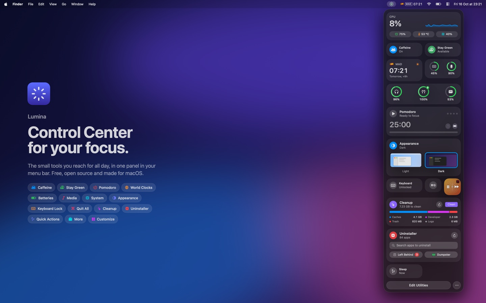
    </picture>
  </a>
</p>

<p align="center">
  <a href="https://github.com/hectorgoan/lumina/releases/latest/download/Lumina.zip"><b>Download Lumina</b></a>
</p>

## Features

<!-- features:start -->
<table>
<tr>
<td width="50%"><a href="docs/marketing/features/caffeine.png">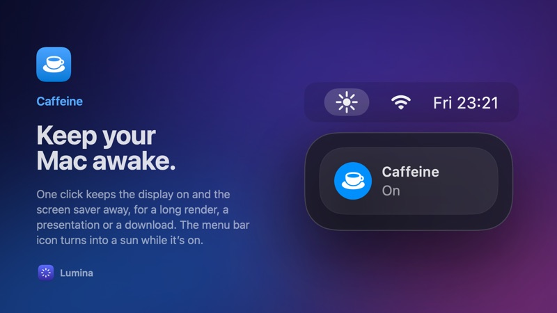</a></td>
<td width="50%"><a href="docs/marketing/features/stay-green.png">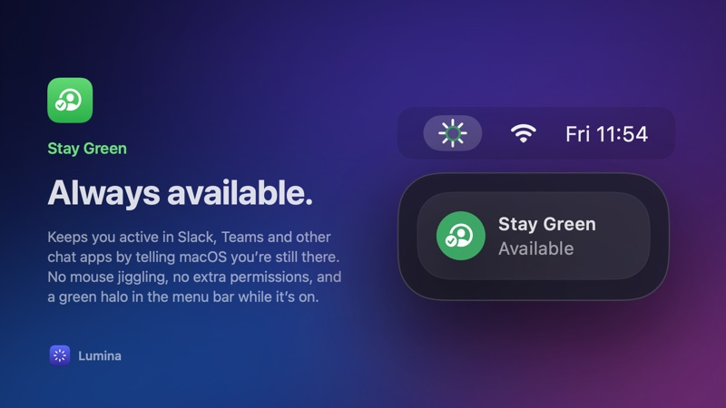</a></td>
</tr>
<tr>
<td width="50%"><a href="docs/marketing/features/pomodoro.png">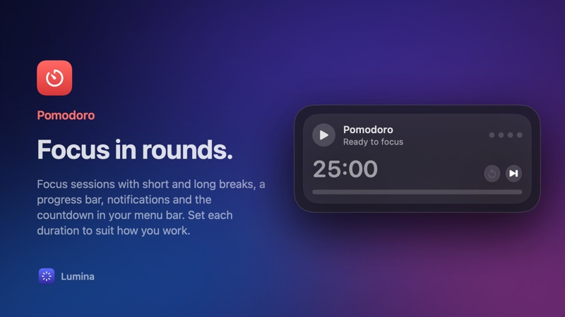</a></td>
<td width="50%"><a href="docs/marketing/features/world-clocks.png">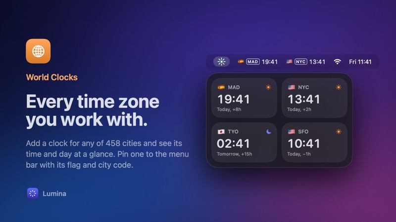</a></td>
</tr>
<tr>
<td width="50%"><a href="docs/marketing/features/batteries.png">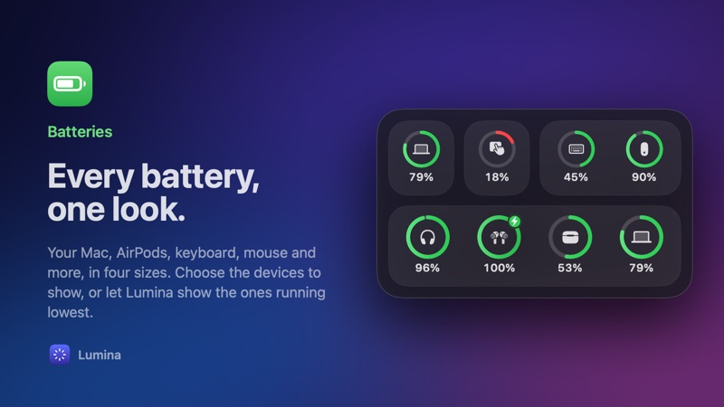</a></td>
<td width="50%"><a href="docs/marketing/features/system.png">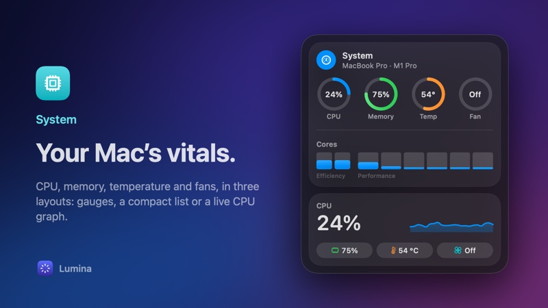</a></td>
</tr>
<tr>
<td width="50%"><a href="docs/marketing/features/appearance.png">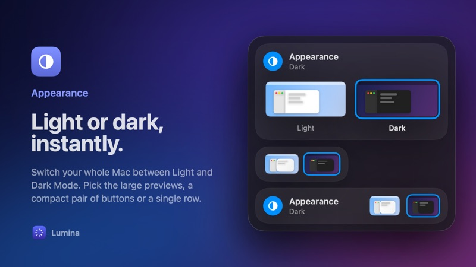</a></td>
<td width="50%"><a href="docs/marketing/features/keyboard-lock.png">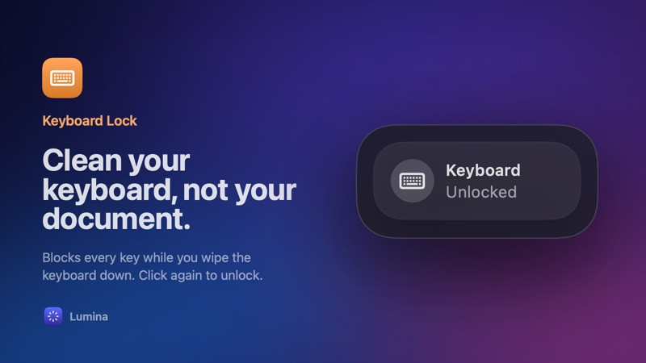</a></td>
</tr>
<tr>
<td width="50%"><a href="docs/marketing/features/quit-all.png">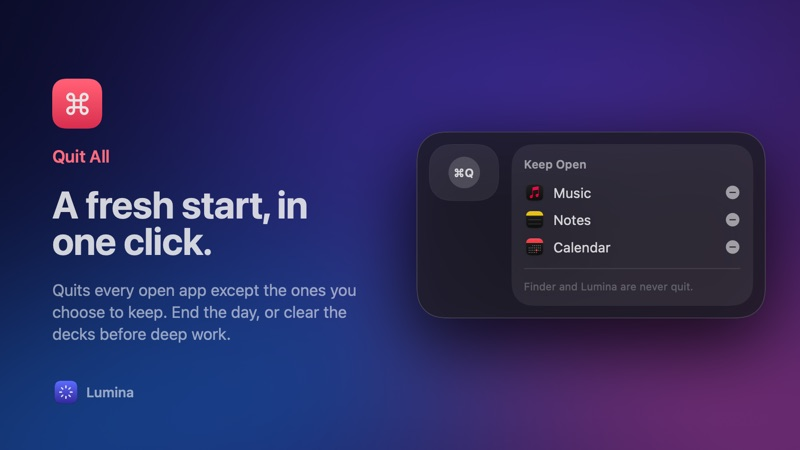</a></td>
<td width="50%"><a href="docs/marketing/features/cleanup.png">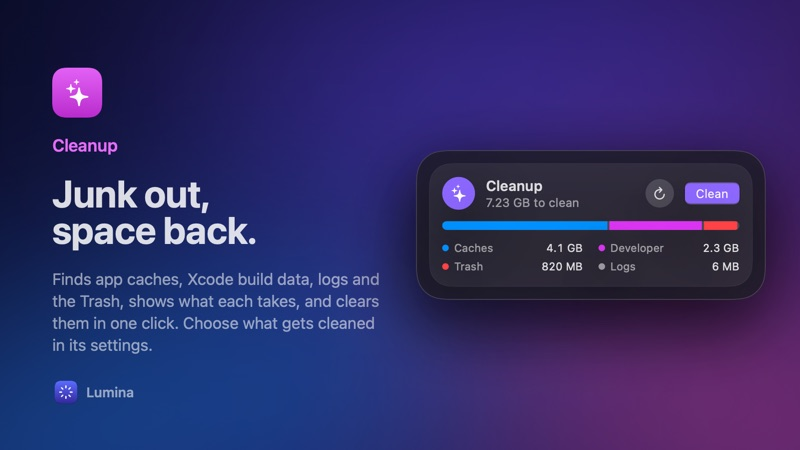</a></td>
</tr>
<tr>
<td width="50%"><a href="docs/marketing/features/uninstaller.png">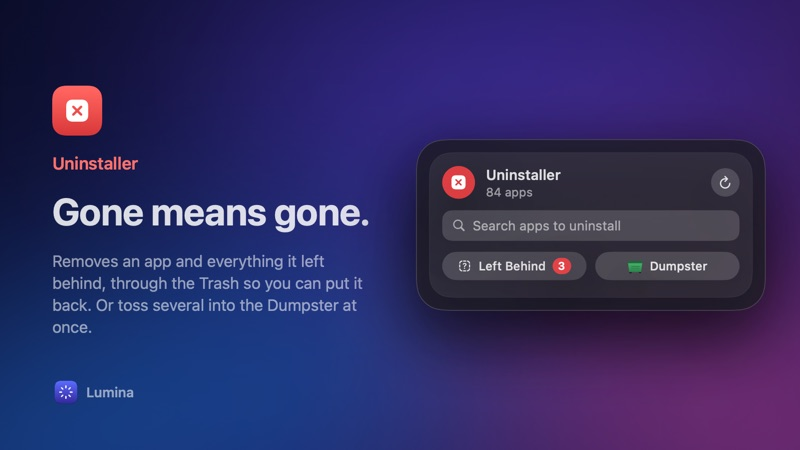</a></td>
<td width="50%"><a href="docs/marketing/features/customize.png">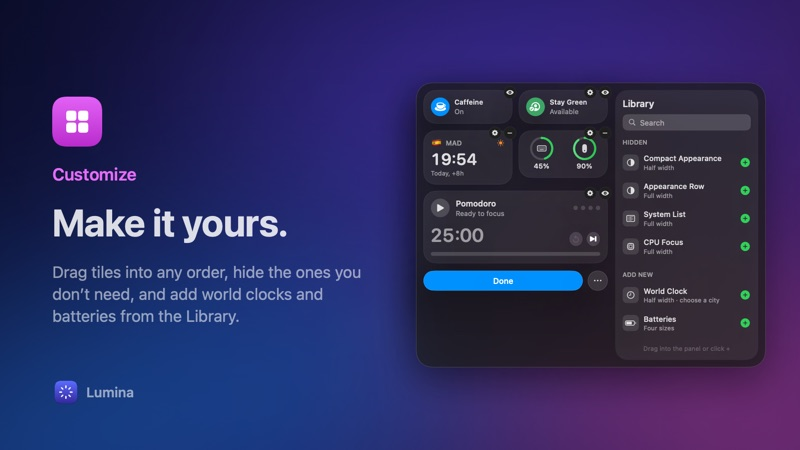</a></td>
</tr>
</table>
<!-- features:end -->

## Installing

1. Download [Lumina.zip](https://github.com/hectorgoan/lumina/releases/latest/download/Lumina.zip) from the latest release and unzip it.
2. Move **Lumina.app** to your Applications folder and open it.
3. Lumina isn't notarized by Apple, so the first time you open it macOS says it can't check it for malicious software. Go to **System Settings › Privacy & Security**, scroll to Security, and click **Open Anyway** next to the message about Lumina.

You only need to do this once. Lumina checks for updates when it opens and every six hours, and shows a banner at the top of its panel when one is ready; you can also choose **Check for Updates…** from the **…** menu. Updates install in place without asking you to allow Lumina again.

Requires macOS 26 or later.

## Utilities

- **Appearance**: switch the system between Light and Dark mode. Two smaller layouts start hidden; show them in edit mode:
  - **Compact Appearance**: just the Light and Dark previews, at half width.
  - **Appearance Row**: the toggle and the previews in a single full-width row.
- **Caffeine**: keep your Mac and its display awake while it's on, so neither sleep nor the screen saver kicks in.
- **Stay Green**: keep chat apps like Microsoft Teams showing you as available while it's on. It tells macOS you're active every 30 seconds, without moving the pointer or needing extra permissions. Your display won't sleep while it's on. Lumina's menu bar icon shows it's on; in its settings, choose the indicator (a dot in place of a ray, a halo around the center, green rays, or none) and whether it's green.
- **Pomodoro**: four 25-minute focus sessions with 5-minute breaks between them, then a 15-minute long break, repeated. You can change all three durations in its settings. Pause, skip or reset any step. Lumina chimes and posts a notification when a step ends and shows the countdown in the menu bar while a session is under way.
- **Cleanup**: frees disk space by removing junk from your own folders. It shows what it found as a bar split by kind, then cleans when you click **Clean** and confirm. It scans when you open the panel if its last scan is older than the interval chosen in its settings (1 minute to 1 hour, 15 minutes by default); turn off **Scan Automatically** to scan only when you click **↻**. In its settings, choose what it cleans:
  - **App Caches** (`~/Library/Caches`), skipping apps that are open unless you turn that off;
  - **Developer Junk**: Xcode's DerivedData and device support files, simulator caches, and npm and Gradle caches;
  - **Logs & Crash Reports** (`~/Library/Logs`);
  - **Trash** (needs Full Disk Access);
  - **Old Downloads** (off by default): files added more than 30 days ago, moved to the Trash;
  - **Mail Attachments** (off by default, needs Full Disk Access): Mail's downloaded copies.

  Everything except old downloads is deleted rather than moved to the Trash. Cleanup never touches system folders, which would need administrator rights.
- **Uninstaller**: removes an app and everything it left in your Library: its Application Support files, caches, containers, preferences, launch agents, saved state, web data and logs. Everything goes to the Trash, so **Put Back** undoes it, or click **Empty Trash** to free the space at once (it empties everything in the Trash). macOS doesn't let apps remove other apps, so Lumina asks Finder to move app bundles to the Trash; the first time, macOS asks to let Lumina control Finder.
  - The tile shows your largest apps not opened in a while (3 months to a year, set in its settings) and a search field for any app.
  - Review what's found before anything moves, grouped by kind with sizes; uncheck a group, or open it to see each file. Apps that are open are quit first.
  - Open the **Dumpster** from the tile: a small window that stays above Finder, to drag several apps into at once.
  - When you delete an app in Finder, Lumina notices and offers to clean up what it left.
  - **Left behind** lists files from apps deleted before, matched by bundle ID.
  - Apps on its **Never Suggest or Uninstall** list are never suggested or removed, and Apple's apps are always protected.

  It only looks in your user Library and matches files by the app's exact bundle ID or name, never partial ones. Checking an app's container may make macOS ask once to let Lumina access other apps' data.
- **Keyboard**: lock the keyboard so you can clean it. Every key, including media and brightness keys, is ignored until you click the tile again; the mouse and trackpad keep working. Needs Accessibility permission.
- **Quit All**: quit every open app with one click, as if you pressed ⌘Q in each. Apps with unsaved changes still ask to save. In its settings, choose apps to keep open; Finder and Lumina are never quit.
- **System**: CPU, memory, CPU temperature and fan speed as gauges, with load for each core, grouped into efficiency and performance cores. Two alternative layouts start hidden; show them in edit mode:
  - **System List**: the same readings as rows with exact values, with the same per-core bars.
  - **CPU Focus**: a compact take with a large CPU figure, its last minute as a graph, and the other readings as pills.

  Temperature and fan speed come from the Mac's System Management Controller, which has no public API. Fan readings are hidden on Macs without fans.
- **World Clock**: a half-width card per city with its flag, city code (MAD, NYC, TYO…), current time, day and night, and how far ahead or behind it is. Add as many as you like from edit mode. In a clock's settings (the gear badge), choose to show it in the menu bar too, as its own item with just the time or with the city code as well. Click a clock in the menu bar to see its day and offset, or to hide it.
- **Batteries**: the charge of your Mac and its Bluetooth accessories (AirPods and their case, keyboards, mice, trackpads), the same devices macOS's own Batteries widget lists. Comes in four sizes: Small (1 device), Medium (2), Large (4) and Extra Large (a list of 6). By default it shows the devices with the lowest charge first; in its settings, change the size or choose devices yourself. Devices appear as they connect.

  The Mac's battery comes from a public API. Accessory levels come from `IOPSCopyPowerSourcesByType`, which IOKit exports but doesn't declare publicly.

Click **Edit Utilities** at the bottom of the panel to customize it. The Library opens beside the panel:

- Drag the modules to rearrange them.
- Click the eye badge on a module to hide it; it moves to the Library. Bring it back with its **+** or by dragging it into the panel.
- Click the gear badge to open a utility's settings, for utilities that have them. While a settings or add page is open, the Library makes way for a live preview of the tile, and comes back when you go back.
- Under **Add New** in the Library, add a **Batteries** widget (pick a size and see it with your devices in the preview) or a **World Clock** (search by city, country or code; use the arrow keys and Return, or click). Clocks and battery widgets show a remove badge (−) instead of the eye.
- Search the Library by name.

Utilities you want set up and ready, but not always on show, go in the **More** section: in edit mode, drag them below its header. Outside edit mode the section stays closed until you open it. In its settings (the gear badge on its header in edit mode, a right-click on the section, or **More Section Settings…** in the **…** menu), choose how it looks:

- **Row** (the default): a row under your utilities with their icons; click to open it below.
- **Pages**: a second page of tiles; click the dots to switch.
- **Stack**: a stack of cards that fans out when clicked.

You can also rename it, and have it remember whether it was open.

Lumina remembers your layout.

## Building

Requires macOS 26 or later and Swift 6.2 or later (Command Line Tools are enough).

```bash
make run
```

This builds `build/Lumina.app`, signs it, and launches it. The build output says which signing identity it used.

The first time you switch appearance, macOS asks for permission to let Lumina control System Events. Keyboard Lock needs Accessibility permission.

### Keeping permissions across rebuilds

By default, builds are signed ad hoc. An ad hoc signature changes with every build, so macOS may ask for Accessibility and Automation permission again after a rebuild. To keep them, sign with a stable identity. You only need to do this once:

```bash
scripts/create-signing-cert.sh
```

This creates a self-signed code-signing certificate named "Lumina Development" in your login keychain. It asks before changing anything and doesn't change any trust settings. At the end it asks for your login password so codesign can use the key without a dialog on every build. If you skip that step, click **Always Allow** the first time a build asks.

From then on, `make run` finds the certificate and signs with it. Grant the permissions once more after the first build signed this way, and later builds keep them.

To sign with a different identity, set `LUMINA_SIGN_IDENTITY` to its name or SHA-1 hash (see `security find-identity -p codesigning`):

```bash
LUMINA_SIGN_IDENTITY="Apple Development: Your Name (TEAMID)" make run
```

To go back to ad hoc signing, delete the "Lumina Development" certificate and its private key in Keychain Access.

## Releasing

Every push to `main` (usually a merged pull request) runs the [Release workflow](.github/workflows/release.yml) on GitHub's macOS 26 runner. It:

1. Builds Lumina and signs it with the "Lumina Development" certificate.
2. Zips the app and signs the zip with Sparkle's update key.
3. Publishes a GitHub Release with `Lumina.zip` and `appcast.xml`, the update feed the app checks.

Versions are `major.minor.run`: the major and minor version come from `CFBundleShortVersionString` in `Resources/Info.plist`, and the patch is the workflow's run number. To release 0.2, change the version in `Info.plist` to `0.2.0`.

Updates use [Sparkle](https://sparkle-project.org). Each update is signed with a private key that only you and the workflow have, and the app checks that signature before installing.

### One-time setup

```bash
scripts/setup-release-secrets.sh
```

This creates Sparkle's update signing key in your login keychain (or reuses an existing one) and writes its public half to `Resources/Info.plist`. It then stores these repository secrets with the GitHub CLI:

- `SPARKLE_PRIVATE_KEY`: the update signing key.
- `LUMINA_CERT_P12` and `LUMINA_CERT_PASSWORD`: the "Lumina Development" certificate, so release builds keep the same signature and macOS keeps Lumina's permissions across updates. Create the certificate first with `scripts/create-signing-cert.sh` if you haven't.

macOS asks you to allow access to the keychain along the way. Commit the updated `Resources/Info.plist` afterwards. The workflow refuses to release until the public key is set.

Keep a backup of the update key (Sparkle's `generate_keys -x` tool exports it). If it's lost, installed copies can't verify new updates.

## Marketing images

`docs/marketing` holds the README's hero images, a social card and a card for every feature:

- `hero-dark.png` and `hero-light.png`: 2880 × 1800 (16:10 at 2x), a desktop with Lumina's panel open below its menu bar icon and the pitch beside it.
- `x-overview.png`: 1600 × 900, X's recommended 16:9 size.
- `features/*.png`: 1600 × 900, one per feature, shown in the [Features](#features) gallery above.
- `readme/`: half-size JPEG copies of the heroes and feature cards (1440 × 900 and 800 × 450), which the README shows so it loads quickly. Each links to its full-size PNG.

They're rendered from the app's real views, so regenerate them after changing the UI:

```bash
scripts/render-marketing.sh
```

The script compiles Lumina's sources, minus its `@main`, together with `scripts/marketing/main.swift` into a small renderer. It also rewrites the gallery between the `features` markers in this README. That file holds the scenes, layouts and copy; `Feature.all` lists each feature's card. Features come from the app, `Utility.catalog` and the Library's **Add New** items, so a new utility gets a card, a pill in the hero and a tile at the end of the hero's panel on the next run. The hero's desktop grows as needed so the panel always fits. Until it has an entry in `Feature.all`, its card is plain and the script prints a warning.

While it runs it turns on Caffeine and Stay Green and samples the system monitor for about 45 seconds, so the CPU graph has history. System readings and clock times are live; battery devices and Cleanup's and the Uninstaller's results are fixed samples (the renderer builds with `MARKETING` defined for that). The light hero sets only the renderer's own appearance, never the system's.

## Adding a utility

1. Create a module view under `Sources/Lumina/Utilities/<Name>/`.
2. Add a `static let` `Utility` for it, choosing a `.full`, `.half` or `.quarter` size and, optionally, a `settings` view (see `PomodoroModule.swift`).
3. Register it in `Utility.catalog`.
4. Give it a card in `Feature.all` (`scripts/marketing/main.swift`) and run `scripts/render-marketing.sh`.

New utilities go to the end of the user's saved order.

## License

Lumina is released under the [MIT License](LICENSE).

Made with ❤️ by [@hectorgoan](https://github.com/hectorgoan).
